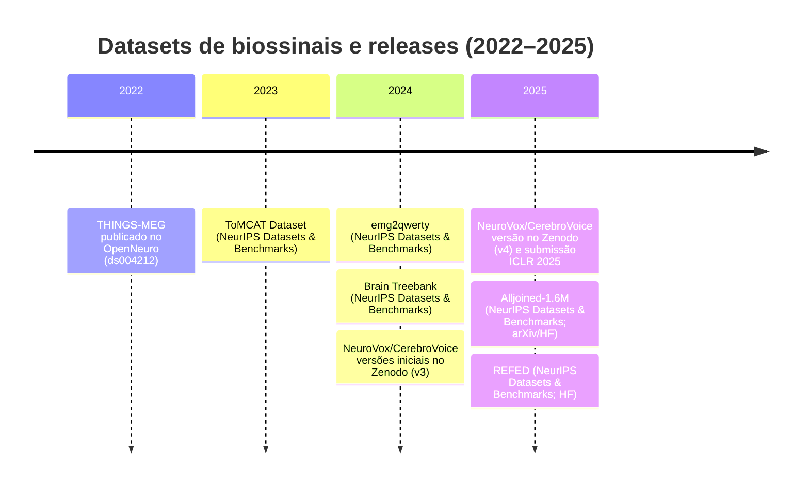

# Datasets de biossinais em NeurIPS, ICML e ICLR (2022–2025) com potencial de re-upload para NEMAR

## Resumo executivo

Esta varredura (2022–2025, inclusive) focou em identificar **datasets de biossinais** (EEG, iEEG/sEEG, fNIRS, MEG, EMG) **propostos ou usados** em trabalhos de NeurIPS, ICML e ICLR e, dentre eles, destacar os que **podem ser candidatos plausíveis** a (re)publicação no ecossistema do **NEMAR via OpenNeuro** (isto é, com distribuição pública compatível e conversão factível para **BIDS**). A busca começou, na ordem solicitada, por **openreview.net**, **neurips.cc**, **proceedings.mlr.press** e **icml.cc**, e depois foi complementada por fontes primárias como **arXiv**, **Zenodo**, **GitHub** e **OpenNeuro**. citeturn6view0turn18view0turn18view1turn18view2turn18view3turn24view0turn29view0turn32view1turn34view0turn43search1turn45search0

Os principais **candidatos fortes** (alta prioridade) identificados nesta amostra são:

- **Brain Treebank** (sEEG/iEEG, NeurIPS 2024 – Datasets & Benchmarks): grande escala, licença **CC BY 4.0**, distribuição direta, metadados/derivados ricos; exige trabalho de conversão para **BIDS-iEEG** e atenção a riscos de reidentificação e a possíveis restrições colaterais ligadas a material audiovisual. citeturn20view0turn22view0turn40view2  
- **CerebroVoice / “NeuroVox”** (sEEG/iEEG + áudio, submetido a ICLR 2025; depósitos no Zenodo): 2 pacientes, fala bilíngue, licença **CC BY 4.0**, já disponibiliza derivados prontos em `.npy`; requer desenho cuidadoso de estrutura BIDS e documentação ética/consentimento para dados invasivos. citeturn34view0turn35view2turn33view0  

Também surgiram datasets relevantes, mas com barreiras típicas para reupload “aberto” (p. ex., licenças **não-comerciais**, termos adicionais de uso, ou **gating** de acesso), o que tende a reduzir prioridade para NEMAR/OpenNeuro:

- **ToMCAT Dataset** (EEG+fNIRS, NeurIPS 2023 – Datasets & Benchmarks): licença **CC BY-NC-SA 4.0** e grande complexidade multimodal; viável como ingestão **parcial** (apenas EEG) se os termos forem compatíveis com re-hosting e se houver anonimização robusta. citeturn18view2turn26view3turn25view2  
- **REFED** (EEG+fNIRS, NeurIPS 2025 – Datasets & Benchmarks): dados em `.mat`, licença **CC BY-NC-SA 4.0** e acesso via Hugging Face com condições adicionais; prioridade tende a ser média/baixa para NEMAR “aberto”. citeturn15view3turn24view0turn24view1  
- **Alljoined-1.6M** (EEG, NeurIPS 2025 – Datasets & Benchmarks; arXiv/Hugging Face): enorme escala, raw em `.edf`; porém com **termos de uso adicionais** e foco “não comercial”, que podem ser incompatíveis com redistribuição no OpenNeuro/NEMAR sem autorização explícita. citeturn18view3turn42view2turn29view0  

Por fim, há datasets já hospedados no **OpenNeuro** e portanto **tipicamente visíveis no NEMAR** (o portal indica “View and analyze … on the NEMAR OpenNeuro portal”), como **THINGS-MEG**; estes não são alvos de “re-upload”, mas entram como **referências de duplicação/overlap** nos papers. citeturn43search1turn43search4  

## Escopo e metodologia

O objetivo foi localizar, nos anos 2022–2025, **(i)** papers que **lançam datasets** (especialmente em trilhas “Datasets and Benchmarks”) e **(ii)** papers metodológicos que **usam explicitamente** datasets públicos de EEG/MEG/iEEG/fNIRS/EMG relevantes para re-hospedagem em NEMAR/OpenNeuro, priorizando sempre fontes primárias (página oficial do paper no venue, PDF do paper, repositório oficial do dataset). citeturn18view0turn18view2turn20view0turn29view0turn34view0turn43search1turn45search10  

Ordem de busca (conforme solicitado):

- **openreview.net**: usado para rastrear entradas de NeurIPS (Datasets & Benchmarks) e submissões/entradas de ICLR que descrevem datasets. citeturn18view0turn18view1turn18view2turn18view3turn7view3  
- **neurips.cc** (incluindo proceedings): usado para confirmar metadados/DOIs e páginas oficiais de posters/papers. citeturn12search1turn20view0  
- **proceedings.mlr.press** (ICML): a varredura inicial sinalizou a presença de múltiplos trabalhos sobre EEG, mas, dentro do orçamento de coleta aqui, **o foco prático deste relatório ficou nos datasets com releases claros e repositórios oficiais acessíveis** (mais frequentes em trilhas de datasets de NeurIPS e em releases via OpenReview/Zenodo). citeturn3search2  
- **icml.cc**: utilizado como fonte oficial para identificar papers recentes (ICML 2022–2025) com menções explícitas de datasets EEG e, quando relevante, seguir para repositórios/DOIs externos. citeturn45search0turn45search6turn45search1  

Complementação por fontes adicionais (quando o paper apontava): **arXiv**, **Zenodo**, **GitHub**, **Hugging Face**, **OpenNeuro** (para checar se já existe dataset em formato BIDS com “View on NEMAR”). citeturn28view0turn32view1turn36view0turn29view0turn43search1turn43search4  

Limitação importante (transparência): “crawling” exaustivo de todos os milhares de papers dos três venues em quatro anos exigiria um pipeline programático (p. ex., APIs do OpenReview + indexação sistemática dos proceedings) e regras de extração (NER + regex) para capturar **todas** as menções a datasets; aqui, o recorte priorizou **datasets explicitamente nomeados e com release rastreável** e que têm caminho plausível para ingestão BIDS/OpenNeuro. citeturn18view0turn45search10turn6view0  

## Datasets identificados e avaliação para re-upload no NEMAR

A tabela abaixo consolida os datasets de biossinais encontrados nesta varredura e que, em diferentes graus, podem ser considerados para ingestão (total ou parcial) no NEMAR via OpenNeuro (BIDS). Quando algum campo não estava disponível em fonte primária acessível, foi marcado como “não especificado na fonte consultada”. citeturn6view0turn22view0turn25view2turn24view1turn29view0turn33view0turn38view0turn43search1  

> **Nota operacional sobre NEMAR/OpenNeuro**: o artigo de referência do NEMAR descreve que o portal “espelha” datasets do OpenNeuro e que novos datasets públicos no OpenNeuro tornam-se disponíveis no NEMAR tipicamente em até ~24h (via DataLad), além de oferecer tooling/compute para EEG/MEG. citeturn6view0  

### Tabela consolidada

| Dataset | Modalidade | Ano e paper (venue) + identificador | Autores e afiliação (primeiro autor et al.) | Descrição curta | Formato e tamanho | URL(s) de acesso | Licença | Pré-processamento / derivados | N sujeitos e demografia | Hardware e taxa(s) de amostragem | Ética/consentimento (notas) | Prioridade para NEMAR (racional) |
|---|---|---|---|---|---|---|---|---|---|---|---|---|
| **Brain Treebank** | iEEG / sEEG | 2024, NeurIPS (Datasets & Benchmarks). DOI: `10.52202/079017-3060` | entity["people","Christopher Wang","neurips 2024 author"] et al.; afiliações incluem entity["organization","Massachusetts Institute of Technology","cambridge, ma, us"] e entity["organization","Harvard University","cambridge, ma, us"]; coleta clínica em entity["organization","Boston Children's Hospital","boston, ma, us"] | sEEG de 10 pacientes assistindo filmes comerciais; alinhamento palavra-a-palavra + anotações linguísticas (UD), além de múltiplas features multimodais | Dados distribuídos em pacotes `.h5.zip`; volume total ~130 GB (zipado) | Site do dataset: `https://braintreebank.dev/` | CC BY 4.0 | Inclui múltiplos artefatos: transcrições, UD parses, anotações de cena/falante, features; sinais com notch 60 Hz + harmônicos (sem downsample/filtragem adicional reportada) | 10 sujeitos (5M/5F), idade 4–19 anos; total 43,5 h; ~1.688 eletrodos no total (varia por sujeito) | Hardware clínico XLTEK/BioLogic; 2048 Hz; depth probes (contatos 2 mm, separação 1,5 mm) | IRB aprovado; consentimento informado; dados anonimizados; docs IRB “sensíveis sob solicitação” | **Alta**: licença aberta, release explícito, grande valor científico. Exige (i) conversão robusta para BIDS-iEEG e (ii) revisão de risco de reidentificação + possíveis restrições indiretas sobre conteúdo audiovisual/frames; mas há caminho claro e ganho alto. citeturn20view0turn22view0turn40view2turn40view0turn23view0 |
| **The ToMCAT Dataset** | EEG + fNIRS (multimodal) | 2023, NeurIPS (Datasets & Benchmarks). (sem DOI no release inicial) | entity["people","Adarsh Pyarelal","neurips 2023 author"] et al.; liderança no entity["organization","University of Arizona","tucson, az, us"] | Dataset de equipes humanas (trios) em missões de busca e resgate em ambiente tipo Minecraft; inclui EEG e fNIRS (além de vários outros sinais e mídias) | Acesso via instância Datasette + arquivos; formatos declarados: SQLite e CSV; sinais brutos gravados em XDF (LabRecorder); tamanho “grande” a ponto de inicialmente não caber em provedores DOI comuns | Página do dataset: `https://tomcat.ivilab.org` | CC BY-NC-SA 4.0 (dados); software MIT | Relata dados “quase brutos” e derivados; inclui pipeline de sincronização/interpolação multi-stream (resampling via MNE e interpolação) | 40 equipes de 3; inclui demografia e questionários (detalhes completos no datasheet) | EEG: actiCHamp Plus (Brain Vision) 500 Hz; fNIRS: NIRSport2 (NIRx) 10,2 Hz; streaming LSL e gravação XDF | Release “de-identified”; recomenda não reidentificar participantes | **Média (parcial)**: relevante, mas (i) licença NC-SA limita redistribuição aberta e (ii) multimodalidade com conteúdos potencialmente identificáveis (faces/áudio etc.) dificulta ingestão integral. Estratégia recomendada: extrair e publicar **somente o subset EEG (e metadados mínimos)** em BIDS-EEG, se juridicamente permitido. citeturn18view2turn25view2turn26view3turn26view2turn25view3 |
| **REFED** | EEG + fNIRS | 2025, NeurIPS (Datasets & Benchmarks). OpenReview: `C4IqLzavel` | entity["people","Xiaojun Ning","neurips 2025 author"] et al.; afiliações incluem entity["organization","Beijing Jiaotong University","beijing, china"], entity["organization","Chinese Academy of Sciences","beijing, china"] e entity["organization","Nanyang Technological University","singapore"] | Dataset afetivo EEG-fNIRS com **anotação dinâmica em tempo real** de valência/arousal durante vídeos emocionais | Estrutura publicada com dados e metadados; sinais em `.mat`; (HF mostra estrutura + metadados CSV e arquivos `.mat`) | Página do paper: `https://openreview.net/forum?id=C4IqLzavel`; site do projeto: `https://refed-dataset.github.io/`; HF: `https://huggingface.co/datasets/REFED2025/REFED-dataset` | CC BY-NC-SA 4.0 | Relata sinais (EEG 64 canais; fNIRS 51 canais), labels estáticos e dinâmicos; detalha shapes em `.mat` e diretórios de anotações | 32 sujeitos saudáveis; 15 vídeos; metadados incluem idade/sexo (no HF) | EEG 1000 Hz; fNIRS 47,62 Hz; fNIRS inclui HbO/HbR/HbT e absorções em 780/805/830 nm | HF exige aceite de condições (compartilhar contato; cláusula “não causar dano”); paper destaca foco em pesquisa | **Média–baixa**: cientificamente útil, mas (i) licença NC-SA, (ii) acesso com condições adicionais (HF) e (iii) parte fNIRS possivelmente fora do escopo “neuroeletromagnético” estrito do NEMAR. Candidato apenas se houver validação de compatibilidade legal e estratégia de ingestão (EEG-only ou EEG+NIRS em padrão BIDS apropriado). citeturn15view3turn24view0turn24view1turn24view2 |
| **Alljoined-1.6M** | EEG | 2025, NeurIPS (Datasets & Benchmarks); arXiv: `2508.18571` | entity["people","Jonathan Xu","alljoined author"] et al.; afiliações incluem entity["organization","University of Waterloo","waterloo, on, canada"] e entity["organization","University of California San Diego","la jolla, ca, us"]; recrutamento local em entity["city","San Francisco","california, us"] | Dataset massivo EEG-para-visão (1,6M trials) coletado com hardware “consumer-grade” (Emotiv Flex 2) para avaliar escalabilidade e robustez | Raw EEG em `.edf`; dataset no HF expõe subsets parquet, mas o EEG completo requer download; paper descreve epocagem (-200ms a 1000ms), baseline e resample 250 Hz | OpenReview: `https://openreview.net/forum?id=1YRXn34Y82`; arXiv HTML: `https://arxiv.org/abs/2508.18571`; HF: `https://huggingface.co/datasets/Alljoined/Alljoined-1.6M` | Declara CC BY-NC-SA 4.0 no HF, mas com **termos adicionais** (ToU, privacidade, possibilidade de revogar acesso etc.) | Pré-processado com MNE; firmware aplica notch 50/60; epocagem, baseline-correction, resampling; paper discute normalização multivariada | 20 adultos; demografia agregada (sexo, faixas etárias, etnia, lateralidade) | Emotiv Flex 2, 32 canais; 256 Hz (resample a 250 Hz); eletrodos Ag/AgCl | Consentimento informado e compensação; há também termos de privacidade/uso no HF | **Média**: tecnicamente excelente (EDF + grande escala), mas juridicamente incerto para re-hosting no OpenNeuro/NEMAR por causa de termos adicionais além da licença CC. Recomendação: obter autorização explícita para “redistribuição em repositório público” (ou publicar apenas metadados/derivados compatíveis). citeturn18view3turn42view2turn41view1turn42view3turn29view0turn29view1 |
| **CerebroVoice** (Zenodo: “NeuroVox”) | iEEG / sEEG + áudio | Submetido a ICLR 2025; Zenodo DOI: `10.5281/zenodo.13332808` | entity["people","Xueyi Zhang","iclr 2025 author"] et al. (OpenReview) | Dataset sEEG bilíngue (Mandarim + Inglês + dígitos) para brain-to-speech e VAD; inclui derivados (LFS/HGA/BBS) e mel-espectrogramas | Zenodo com múltiplos `.zip` (centenas de GB total reportado); paper descreve arquivos `_SEEG.npy` e `_MEL.npy` (pré-processados) | OpenReview: `https://openreview.net/forum?id=3sfOGsBh85`; Zenodo: `https://zenodo.org/records/13332808`; GitHub citado: `https://github.com/Brain2Speech2/B2S2` | CC BY 4.0 (Zenodo) | Pré-processamento descrito: bipolar referencing; remoção de eletrodos “anormais”; extração LFS/HGA e downsample a 200 Hz para features; áudio downsample a 16 kHz e mel | 2 pacientes; ~73 e ~76 min de gravação (por sujeito); contagem de canais pós-filtragem reportada (114 e 158 remanescentes após remoções) | sEEG gravado a 1000 Hz ou 500 Hz (Nihon Kohden EEG 1200); eletrodos depth (platinum-iridium, Sinovation) | Acesso citado via Zenodo (e, em material suplementar, via formulário); “apenas pesquisa, não uso clínico” | **Alta**: licença aberta (CC BY), DOI, foco iEEG (forte aderência ao escopo NEMAR). Exige conversão para BIDS-iEEG (raw + eventos + sincronização áudio) e checklist de privacidade para dados clínicos. citeturn7view3turn34view0turn35view2turn33view0turn33view3turn32view0 |
| **emg2qwerty** | EMG / sEMG | 2024, NeurIPS (Datasets & Benchmarks). (repo aponta paper arXiv associado `2410.20081`) | entity["people","Viswanath Sivakumar","neurips 2024 author"] et al.; criador no contexto entity["company","Meta","menlo park, ca, us"] (Reality Labs) | sEMG em punhos para “touch typing”; grande escala (346h), com ground truth (keylogger) e benchmarks | 1.135 arquivos HDF5 + `metadata.csv`; download tarball | GitHub: `https://github.com/facebookresearch/emg2qwerty`; download: `https://fb-ctrl-oss.s3.amazonaws.com/emg2qwerty/emg2qwerty-data-2021-08.tar.gz` | CC BY-NC-SA 4.0 (arquivo LICENSE) | Pós-processamento mínimo: checks, high-pass 40 Hz, correção de drift e sincronização bands; fornece script para converter a BIDS (adaptado ao projeto) | 108 participantes; 1.135 sessões; 346,4 h | sEMG-RD com 16 pares diferenciais por device (2 devices: esquerda/direita); 2 kHz, 12 bits; bandpass 20–850 Hz (pré-digitalização) | IRB aprovado; consentimento; dados de-identificados | **Baixa para NEMAR**: apesar de excelente dataset, EMG periférico geralmente não é foco do NEMAR (portal voltado a EEG/MEG/iEEG). Pode ser candidato a repositórios BIDS-generalistas, mas NEMAR tende a não ser o destino prioritário. citeturn19view1turn39view0turn39view2turn36view0turn38view0turn18view1 |
| **EEG-ImageNet** | EEG | Submetido a ICLR 2025 (paper “under review”) | Autores não inferíveis com segurança a partir do PDF (duplo-cego no texto); paper afirma liberação via GitHub pós-review | EEG com 16 sujeitos expostos a 4000 imagens (ImageNet); benchmark para classificação e reconstrução | Formato anunciado: dois arquivos `.pth` (8 sujeitos cada) via cloud link no GitHub pós-review | (não há URL pública explícita no PDF consultado) | não especificado na fonte consultada | Paper menciona consentimento e liberação pública de dados anonimizados; aponta vieses (p. ex., demografia/mão dominante) | 16 sujeitos; “todos destros” (no texto) | não especificado na fonte consultada | Comitê de ética + consentimento informado declarados; alerta de vieses | **Baixa (por ora)**: dataset parece promissor, mas não há link/licença pública verificável no material acessado; só reavaliar quando o repositório e termos estiverem publicamente estáveis. citeturn9view0turn30view0 |
| **THINGS-MEG** (já no OpenNeuro/NEMAR) | MEG | OpenNeuro dataset `ds004212` (publicado 2022; versões atualizadas) | Consórcio THINGS-data (metadados no OpenNeuro) | MEG para representações de objetos; parte da família THINGS-data | BIDS (OpenNeuro); possui DOI por versão (no OpenNeuro) | OpenNeuro: `https://openneuro.org/datasets/ds004212` | (licença/termos no OpenNeuro; já compatível com OpenNeuro/NEMAR) | BIDS validado; pronto para análise; NEMAR indica “View and analyze…” | n/a (ver metadados OpenNeuro) | n/a | n/a | **Não aplicável (já está)**: como já está no OpenNeuro com integração explícita ao NEMAR, não é candidato a “re-upload”; entra como dataset de referência/overlap em papers. citeturn43search1turn43search4 |

## Duplicatas, overlaps e status no NEMAR

### Duplicatas e famílias de datasets

Alguns datasets aparecem como “família” ou base de comparação entre papers:

- **Alljoined-1.6M** foi desenhado para comparação explícita com **THINGS-EEG2** (não localizado como dataset OpenNeuro nesta varredura) e compartilha estímulos da iniciativa THINGS, sendo natural esperar sobreposição conceitual (mesma taxonomia de objetos/estímulos) com outros datasets THINGS, incluindo **THINGS-MEG** e o dataset EEG THINGS disponível no OpenNeuro (ex.: ds003825). citeturn42view2turn43search6turn43search1  
- A coexistência de **Brain Treebank** e **CerebroVoice** evidencia duas linhas de datasets iEEG “speech/language”: (i) linguagem naturalística em filmes com anotação linguística profunda (Brain Treebank) e (ii) fala controlada bilíngue com pareamento direto a sinal de fala (CerebroVoice). Isso sugere oportunidades de padronização de metadados (tarefas, eventos, alinhamentos áudio-texto) para reuso em benchmarks comuns no NEMAR. citeturn40view2turn35view2turn34view0  
- Entre multimodais EEG+fNIRS, **ToMCAT** e **REFED** compartilham o desafio de sincronização e representação em padrão BIDS (e.g., múltiplas streams e frequências), mas diferem no desenho experimental (tarefas colaborativas vs. indução emocional com anotação contínua). citeturn26view0turn15view3turn25view3  

### Datasets já no NEMAR

O portal do OpenNeuro mostra, para alguns datasets, um link explícito “View and analyze this dataset on the NEMAR OpenNeuro portal…”, o que sinaliza presença/integração no ecossistema NEMAR; **THINGS-MEG** é um exemplo claro deste caso. citeturn43search4turn6view0  

Para esses casos, o trabalho de ingestão para NEMAR não é reupload, mas sim:

- validar se a versão desejada (p. ex., `v3.0.0`) é a versão correta para o benchmark; citeturn43search4  
- produzir e publicar **derivados BIDS** (BIDS-Derivatives) e scripts/referências para reprodutibilidade, quando aplicável. citeturn6view0  

## Barreiras legais e éticas prováveis

### Licenciamento e termos de uso

Para ingestão via OpenNeuro/NEMAR, a principal fonte de atrito costuma ser **licença/ToU**:

- Licenças **CC BY 4.0** (Brain Treebank, CerebroVoice/NeuroVox) tendem a ser mais compatíveis com redistribuição ampla, desde que os dados estejam realmente anonimizados e sem restrições contratuais paralelas. citeturn22view0turn33view0turn35view3  
- Licenças **CC BY-NC-SA 4.0** (ToMCAT, REFED, emg2qwerty, Alljoined via HF) indicam restrição não-comercial e share-alike, o que pode ser aceitável em alguns cenários acadêmicos, mas pode conflitar com “política default” de alguns repositórios e com reuso por terceiros em contextos comerciais; isso exige validação jurídica antes de qualquer re-hosting. citeturn25view0turn24view0turn38view0turn29view1  
- **Alljoined-1.6M** adiciona uma camada de risco: além de CC, o card no Hugging Face inclui termos adicionais (ToU/Privacy Policy/possibilidade de término de acesso), o que pode ser incompatível com a ideia de um repositório público espelhável como OpenNeuro/NEMAR sem autorização formal. citeturn29view0turn42view3  

### Privacidade, reidentificação e dados clínicos

- **Brain Treebank** envolve pacientes pediátricos/adolescentes (4–19 anos) em contexto hospitalar; embora “anonymized” e com IRB/consentimento, dados invasivos e metadados ricos (tempo, estímulos, transcrições) aumentam a necessidade de avaliação de risco de reidentificação e do que exatamente está sendo redistribuído (ex.: “movie_frames.zip” para verificação). citeturn22view0turn40view2  
- **CerebroVoice** também envolve pacientes clínicos com sEEG; o paper descreve remoção de eletrodos considerados anormais e disponibiliza features e áudio; isso demanda checklist de privacidade (e.g., áudio pode conter biometria vocal, mesmo que seja leitura controlada). citeturn35view2turn34view0  
- **ToMCAT** explicitamente inclui múltiplas modalidades com potencial identificável (p. ex., face images, áudio de diálogo, eye-tracking), então ingestão “integral” no OpenNeuro/NEMAR é improvável; um caminho mais seguro é ingestão **somente do EEG** com eventos e sem mídias sensíveis, se permitido pelos termos. citeturn18view2turn25view3  
- **REFED** e seu gating/condições no Hugging Face sugerem preocupação adicional com uso responsável; isso deve ser compatibilizado com a filosofia de acesso do repositório-alvo. citeturn24view1turn24view0  

## Recomendações técnicas para ingestão no NEMAR

### Estratégia recomendada de ingestão

A estratégia mais alinhada ao desenho do ecossistema descrito para NEMAR é:

1. **Publicar (ou republicar) no OpenNeuro em formato BIDS**, garantindo validação e documentação; citeturn6view0  
2. Contar com o espelhamento/integração do NEMAR (tipicamente em ~24h após o dataset ficar público no OpenNeuro). citeturn6view0  

### Mapeamento mínimo de metadados para BIDS

Recomendações práticas (por dataset):

- **Brain Treebank (HDF5)**:  
  - Converter sinais para um formato aceito pelo BIDS-iEEG (p. ex., EDF/BrainVision), preservando taxa de amostragem (2048 Hz) e canais; citeturn40view0turn22view0  
  - Criar `electrodes.tsv`/`channels.tsv` e coordenadas (o dataset já fornece pacotes de “localization” e labels), além de `events.tsv` para word onsets/offsets e eventos (pause/resume etc.). citeturn22view0turn40view0  
  - Documentar claramente o que é redistribuído sobre filmes (frames, transcrições, features) e remover/abstrair qualquer artefato com risco de violação de copyright, se necessário. citeturn22view0turn20view0  

- **CerebroVoice/NeuroVox (NPY + Zenodo)**:  
  - Decidir se a ingestão será do **raw** (se presente nos `.zip`) ou apenas dos **derivados** (`_SEEG.npy`, `_MEL.npy`). O BIDS favorece raw + derivados separados; citeturn35view2turn33view3  
  - Padronizar sessões/tarefas (Mandarim/inglês/dígitos) e estruturar `events.tsv` com alinhamento a áudio/mel; citeturn34view0turn35view1  
  - Incluir `participants.tsv` com o mínimo permitido (muitas vezes “n/a” para dados clínicos) e anexar notas de consentimento/uso “research-only”. citeturn35view3turn32view0  

- **ToMCAT (XDF/SQLite/CSV)**:  
  - Se o objetivo for NEMAR, priorizar **exportação do EEG** para BIDS-EEG e derivar `events.tsv` a partir de logs/sincronização; citeturn26view3turn25view3  
  - Manter fNIRS em BIDS-NIRS apenas se o pipeline NEMAR/OpenNeuro do projeto aceitar e se a equipe desejar (caso contrário, manter fNIRS fora do escopo NEMAR); citeturn26view2turn6view0  
  - Revalidar se CC BY-NC-SA permite re-hosting em repositório público de terceiros. citeturn25view0  

- **REFED (MAT + HF)**:  
  - Converter EEG (e fNIRS, se aplicável) para estrutura BIDS (EEG: `.edf`/BrainVision; metadados e eventos das anotações dinâmicas); citeturn24view1turn15view3  
  - Resolver barreira de acesso “condicionado” (HF) e garantir que a redistribuição no OpenNeuro não viola as condições de acesso; citeturn24view1turn24view0  
  - Se necessário, publicar apenas o subset EEG com metadados mínimos. citeturn15view3  

- **Alljoined-1.6M (EDF já existe)**:  
  - Do ponto de vista técnico, o dataset já indica raw em `.edf`, epocagem e pré-processamento (baseline, resampling) — o que facilita conversão para BIDS-EEG; citeturn42view1turn42view3  
  - O gargalo é jurídico/ToU; recomenda-se obter autorização explícita de redistribuição (ou publicar apenas metadados/derivados). citeturn29view0turn29view1  

### Checagens de qualidade antes de upload

- Executar validação BIDS (bids-validator) e checagem de consistência (frequências, unidades, nomes de canal, eventos). A experiência do NEMAR com ingestão e ferramentas em torno do OpenNeuro/BIDS sugere que validação e padronização são essenciais para interoperabilidade e análise no portal. citeturn6view0  

## Linha do tempo e fluxo de ingestão

### Linha do tempo de releases e marcos (mermaid)



Os pontos acima são suportados pelas datas e versões nas páginas oficiais correspondentes (OpenNeuro/Zenodo/OpenReview/arXiv). citeturn43search1turn18view2turn18view1turn18view0turn32view2turn32view1turn18view3turn24view0  

### Fluxo proposto de ingestão para NEMAR/OpenNeuro (mermaid)

```mermaid
flowchart TD
    A[Identificar dataset candidato em paper (NeurIPS/ICML/ICLR)] --> B[Confirmar repositório oficial e versão (Zenodo/GitHub/HF/site institucional)]
    B --> C[Auditoria legal: licença + ToU + permissões de redistribuição]
    C -->|OK| D[Auditoria ética: anonimização, risco de reidentificação, consentimento/IRB]
    C -->|Não OK| C2[Negociar permissão ou limitar escopo (EEG-only / derivados)]
    D -->|OK| E[Download + verificação de integridade (hashes, estrutura)]
    E --> F[Extração de metadados: participantes, canais, eventos, hardware, taxas]
    F --> G[Conversão para BIDS (EEG/MEG/iEEG) + derivados]
    G --> H[Validação BIDS + QA de sinais/eventos]
    H --> I[Upload para OpenNeuro (dataset público)]
    I --> J[NEMAR espelha e disponibiliza (via OpenNeuro/NEMAR)]
    J --> K[Publicar scripts de conversão + README + citações + proveniência]
```

A etapa final (espelhamento via OpenNeuro → NEMAR) reflete o modelo descrito na literatura do NEMAR, que enfatiza integração com OpenNeuro e disponibilização rápida após publicação. citeturn6view0